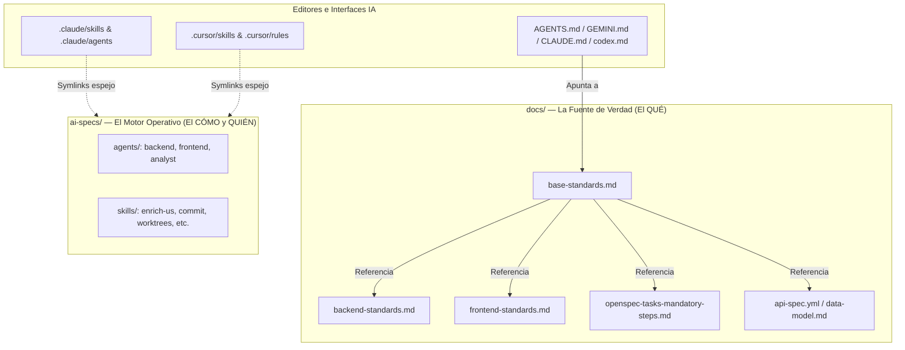

# Plantilla Portátil "AI Harness" (Augmented Spec-Driven Development)

Este paquete contiene la **plantilla portátil de "AI Harness"** para desarrollo guiado por especificaciones (_Augmented Spec-Driven Development_).

Sirve para inyectarse en cualquier proyecto y obligar a cualquier asistente de IA (Claude, Cursor, Gemini, Copilot) a seguir reglas estrictas de arquitectura, TDD y flujos de trabajo sin inventar ni saltarse pasos.

---

### 1. Mapa de Conexión de Archivos



- **Punto de Entrada Único**: Los archivos raíz (`AGENTS.md`, `CLAUDE.md`, `GEMINI.md`, `codex.md`) apuntan a `docs/base-standards.md`.
- **Portabilidad mediante Symlinks**: `.claude/` y `.cursor/` contienen enlaces simbólicos que apuntan a la fuente canónica en `ai-specs/`. Si actualizas `ai-specs/`, todos los editores se actualizan a la vez.
- **Empaquetado**: Contiene la estructura lista para copiar directamente en la raíz de cualquier proyecto nuevo.

---

### 2. Carpeta `docs/` — El "QUÉ" (Reglas y Contexto Técnico)

Define la **única fuente de verdad** (_Single Source of Truth_) sobre cómo se escribe código en el proyecto:

| Archivo                                                                         | Propósito principal                                                                                                                                                       |
| :------------------------------------------------------------------------------ | :------------------------------------------------------------------------------------------------------------------------------------------------------------------------ |
| [`base-standards.md`](./docs/base-standards.md)                                 | **Reglas nucleares no negociables**: TDD estricto, tareas atómicas (_baby steps_), 100% tipado, inglés obligatorio, cobertura >90%.                                       |
| [`backend-standards.md`](./docs/backend-standards.md)                           | Arquitectura backend: Domain-Driven Design (DDD), Clean Architecture, Express, Prisma ORM, manejo de errores y seguridad.                                                 |
| [`frontend-standards.md`](./docs/frontend-standards.md)                         | Patrones de componentes React, UI/UX, arquitectura de estado y testing frontend.                                                                                          |
| [`openspec-tasks-mandatory-steps.md`](./docs/openspec-tasks-mandatory-steps.md) | **Checklist obligatorio** al generar tareas: Crear rama `feature/*` (Paso 0), tests unitarios, verificar BD, ejecución manual de `curl` por el propio agente y tests E2E. |
| [`api-spec.yml`](./docs/api-spec.yml) y [`data-model.md`](./docs/data-model.md) | Contrato OpenAPI 3.0 y esquemas de base de datos de ejemplo (se adaptan según el proyecto).                                                                               |
| [`documentation-standards.md`](./docs/documentation-standards.md)               | Pautas para mantener la documentación viva y actualizada con cada cambio de código.                                                                                       |

---

### 3. Carpeta `ai-specs/` — El "CÓMO" y "QUIÉN" (Harness Operativo)

Define **quién ejecuta** y **qué recetas/habilidades** sigue la IA:

#### A. Agentes Especializados (`ai-specs/agents/`)

Asignan un rol mental a la IA antes de actuar:

- [`backend-developer.md`](./ai-specs/agents/backend-developer.md): Diseña primero el plan DDD (Entidades, Repositorios, Servicios, Controladores). _Nunca implementa a lo loco; primero planifica_.
- [`frontend-developer.md`](./ai-specs/agents/frontend-developer.md): Experto en React, diseño modular y accesibilidad.
- [`product-strategy-analyst.md`](./ai-specs/agents/product-strategy-analyst.md): Descompone historias de usuario ambiguas en requisitos técnicos sólidos.

#### B. Skills / Workflows (`ai-specs/skills/`)

Procedimientos que la IA invoca bajo demanda según la fase:

- [**/enrich-us**](./ai-specs/skills/enrich-us): Enriquece un ticket vago (ej. de Jira vía MCP) con criterios de aceptación antes de tocar código.
- [**using-git-worktrees**](./ai-specs/skills/using-git-worktrees): Crea un entorno de trabajo Git aislado (_worktree_) para que la IA trabaje sin ensuciar la rama principal.
- [**code-auditing**](./ai-specs/skills/code-auditing) & [**adversarial-review**](./ai-specs/skills/adversarial-review): Auditoría en 6 fases y revisión tipo "red-team" para buscar vulnerabilidades o deuda técnica antes de fusionar.
- [**sync-agent-symlinks**](./ai-specs/skills/sync-agent-symlinks): Revisa y repara automáticamente los enlaces simbólicos en `.claude` y `.cursor`.
- [**commit**](./ai-specs/skills/commit): Genera _conventional commits_ atómicos y prepara la Pull Request.

---

### 4. Flujo de Trabajo (Workflow End-to-End)

El ciclo estándar que sigue un desarrollador con este arnés (integrado con [OpenSpec](https://github.com/Fission-AI/OpenSpec)):

```text
1. REFINAR       ➔ /enrich-us TICKET-ID        (Aclara el alcance y criterios)
2. ESPECIFICAR   ➔ /ff TICKET-ID               (Genera la spec y tasks.md con pasos obligatorios)
3. IMPLEMENTAR   ➔ /apply TICKET-ID            (La IA asume el rol y ejecuta tarea por tarea con TDD)
4. VERIFICAR     ➔ /verify TICKET-ID           (La IA ejecuta pruebas y comprueba endpoints)
5. AUDITAR       ➔ /adversarial-review         (Revisión de seguridad y calidad estilo red-team)
6. ARCHIVAR      ➔ /archive TICKET-ID          (Guarda la spec en el histórico de cambios)
7. PUBLICAR      ➔ /commit                     (Crea commits convencionales y prepara la PR)
```

---

### Resumen en una frase

> **`docs/`** le dice a la IA **qué estándares técnicos y reglas no puede romper**, mientras que **`ai-specs/`** le dice **qué rol asumir y qué pasos sistemáticos ejecutar** para entregar código probado y documentado.
